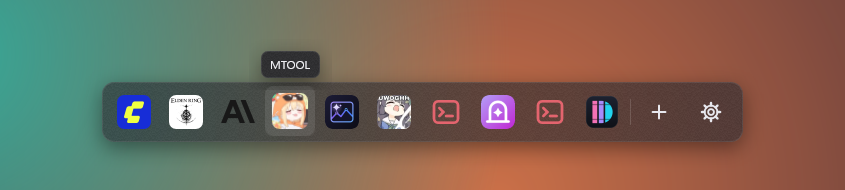
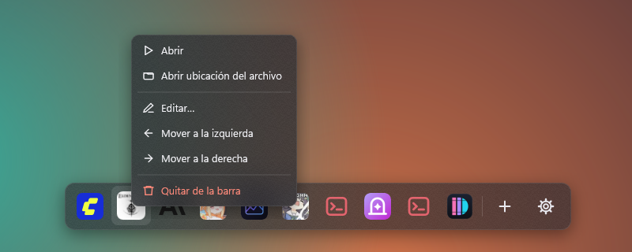
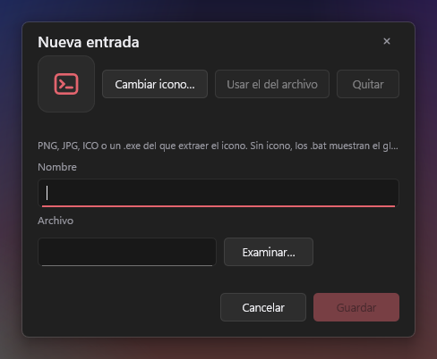
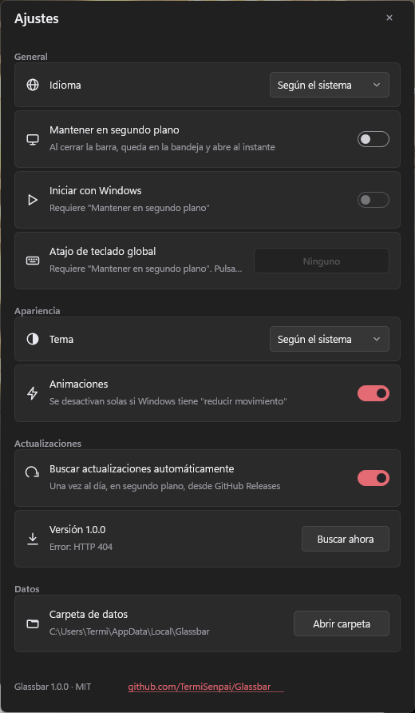

# Glassbar

Una segunda barra de herramientas de cristal para Windows. Ánclala a la barra de tareas, haz clic, y tus scripts y programas aparecen en una barra translúcida sobre la barra de tareas. Haz clic en uno para lanzarlo; la barra se quita de en medio.

Rust nativo sobre Win32, DirectComposition y Direct2D. Un único ejecutable de 600 KB sin runtime que instalar. No queda nada en segundo plano salvo que tú lo pidas.

[English version](README.md)



## Instalar

1. Descarga `Glassbar.exe` de la [última release](https://github.com/TermiSenpai/Glassbar/releases/latest).
2. Déjalo donde quieras.
3. Clic derecho y **Anclar a la barra de tareas**.

El objetivo es Windows 11. En Windows 10 (1903 o posterior) funciona con fondo sólido en la ventana de ajustes en lugar de Mica.

Si usabas BatLauncher, tus entradas e iconos se importan solos la primera vez que arranca Glassbar. La carpeta antigua no se toca.

## Uso

| Acción | Cómo |
|---|---|
| Abrir la barra | Clic en el icono anclado. |
| Lanzar una entrada | Clic en su icono, o enfócala con las flechas y pulsa Enter. |
| Cerrar la barra | Escape, clic en cualquier otro sitio, o lanzar una entrada. |
| Añadir una entrada | Clic en **+**, o arrastra archivos `.bat`, `.cmd`, `.exe` o `.lnk` sobre la barra o sobre la ventana de nueva entrada. Los accesos directos se resuelven a su destino, así que el `.lnk` puede borrarse después. |
| Editar, reordenar, quitar | Clic derecho en un icono. |
| Muchas entradas | La barra se limita al 80 % de la pantalla y pasa a carrusel: arrástralo, usa la rueda o las flechas de los extremos. |
| Ajustes | Clic en el engranaje. |





### Mantener en segundo plano

Apagado por defecto. Activa **Mantener en segundo plano** en Ajustes para que Glassbar quede en la bandeja del sistema, abra al instante, y permita:

- **Iniciar con Windows**
- **Atajo de teclado global**, por ejemplo Win + Alt + Espacio



### Actualizaciones

Glassbar consulta GitHub Releases una vez al día en segundo plano (se puede apagar) y muestra un punto en el engranaje cuando hay versión nueva. No se reemplaza nada hasta que pulses **Actualizar**; la descarga se verifica contra el `SHA256SUMS` publicado antes de cambiar el ejecutable.

## Datos

Todo vive en `%LOCALAPPDATA%\Glassbar`:

```
entries.json     tus entradas y su orden
settings.json    ajustes
icons\           iconos personalizados copiados
icons.cache      mapas de bits de iconos ya escalados
log.txt          registro (rota al superar 1 MB)
```

El único valor de registro que Glassbar escribe es `HKCU\Software\Microsoft\Windows\CurrentVersion\Run\Glassbar`, y solo mientras **Iniciar con Windows** esté activado.

## Compilar

Requiere Rust estable y el Windows SDK (por el compilador de recursos).

```
cargo build --release
```

El ejecutable queda en `target\release\Glassbar.exe`. `cargo test` ejecuta los tests unitarios. Arranca la app con `--perf` para anotar las fases de arranque en `log.txt`; las medidas de la máquina de referencia están en [docs/perf.md](docs/perf.md).

## Cómo funciona

- La barra es una ventana popup sin bitmap de redirección; todo lo que hay en ella son visuales de DirectComposition dibujados una vez con Direct2D. Las animaciones las ejecuta el compositor de Windows, así que la app no trabaja por frame.
- El cristal es una instantánea: lo que hay detrás de la barra se captura y se desenfoca una vez por apertura, lo que permite que el plato entero se funda y se deslice. Los ajustes usan el Mica del sistema donde existe.
- El dibujo usa el dispositivo por software WARP a propósito: crear un dispositivo por hardware carga el driver de la GPU y cuesta cientos de milisegundos por proceso, mientras que WARP cuesta unos 30 ms. La composición sigue siendo en GPU.
- Los iconos se guardan en caché como mapas de bits ya escalados, así que un arranque en frío no decodifica nada.

Las notas de diseño están en `docs/superpowers/`. La aplicación WPF anterior se conserva en la rama `legacy-wpf`.

## Licencia

MIT
